# MANGALNAUTS — Martian Mission OS, 3D Digital Twin & Autonomous Route Navigator

> **NASA International Space Apps Challenge**  
> *Challenge Track: Interplanetary Survival Guide — Martian Map*  
> **Live Deployment:** [mangalnauts.vercel.app](https://mangalnouts.vercel.app/)


## 1. Project Overview

**MANGALNAUTS** is a dual-viewport, multi-scale **Planetary Geospatial Cockpit and Autonomous Traversal Operating System** engineered for the next era of human and robotic Martian surface exploration.

Navigating the Martian frontier requires more than static satellite photographs: mission planners, astronauts on Extravehicular Activity (EVA), and autonomous rovers must simultaneously balance **extreme topography**, **radiation hazards**, **In-Situ Resource Utilization (ISRU)** opportunities, **geological science priorities**, and **strict physical locomotion constraints**.

MANGALNAUTS solves this challenge by unifying:
1. **Google Earth–Style 3D Digital Twin**: A true Martian ellipsoid globe with 10 NASA Trek orbital basemaps, USGS digital elevation models, real-time day/night solar illumination, and spacecraft ephemeris orbits.
2. **Tactical 2D High-Resolution Surface Map**: 5 m/pixel Murray Lab CTX mosaics and MColorDEM relief across three key Martian exploration sectors (**Jezero Crater**, **Gale Crater**, and **Olympus Mons**).
3. **In-Situ Resource Utilization (ISRU) Mineralogy Engine**: Global Odyssey Gamma Ray Spectrometer (GRS) datasets for 6 key elements ($K, H_2O, Fe, Si, Cl, Th$), coupled with localized MRO CRISM hyperspectral mineralogy and THEMIS thermal inertia.
4. **Multi-Modal Route Planner & Physics Engine**: A* traversability pathfinding enforcing strict physical slope limits ($\le 15^\circ$ for astronaut EVA Marswalks; $\le 20^\circ$ for heavy rovers), responsive cross-section elevation profiles, and consumable expenditure forecasts ($O_2$, Sabatier $CH_4$ yield, extractable water, battery Wh).
5. **Graph Neural Network (GNN) Traversability Model**: A 2-layer Graph Convolutional Network (GCN) scoring surface nodes by safety risk and scientific biosignature priority.
6. **Live NASA Open API Telemetry**: Real-time Martian weather (Curiosity REMS, InSight, Perseverance MEDA), Sol clock, Local True Solar Time (LTST), and NOAA SWPC space weather radiation dosimetry.
7. **Historical Ground Truth & Natural Shelters**: 5 verified NASA rover traverse records and 1,062+ cataloged Martian lava tube skylights for cosmic radiation protection.

---

## 2. System Architecture

```mermaid
flowchart TD
    subgraph NASA_Data_Layer [NASA & USGS Planetary Data Sources]
        A1[NASA Mars Trek WMTS<br/>Viking, MOLA, THEMIS, TES]
        A2[USGS / Esri OnMars MDEM200M<br/>Digital Elevation Models]
        A3[NASA 2001 Mars Odyssey GRS<br/>K, H2O, Fe, Si, Cl, Th Rasters]
        A4[MRO CRISM & THEMIS<br/>Hyperspectral & Thermal Inertia]
        A5[NASA Open API api.nasa.gov<br/>Perseverance MEDA & Curiosity REMS]
    end

    subgraph Processing_Engine [MANGALNAUTS Core Engine]
        B1[True Mars IAU/IAG Ellipsoid<br/>CesiumJS WebGL Engine]
        B2[Tactical Surface Detail Engine<br/>Leaflet & Murray Lab CTX 5m/px]
        B3[ISRU Geochemical Processor<br/>Corridor Element Sampling]
        B4[Multi-Modal A* Path Solver<br/>Marswalk ≤15° vs Rover ≤20°]
        B5[2-Layer GCN Safety Network<br/>Risk vs Science Yield]
    end

    subgraph Cockpit_UI [Mission Cockpit & HUD]
        C1[Dual / Split View Synchronizer<br/>Cosmos Flyby & Oblique Tilt]
        C2[Route Mineral Swath Track<br/>6-Element Selector & Corridor Stats]
        C3[Responsive Elevation Scrubber<br/>Cross-Section Profile & Slope Alerts]
        C4[Environmental Telemetry Bar<br/>LTST, Sol, Temp, Pressure, Rad Dose]
        C5[Airlock Safety & Hazard Engine<br/>Perchlorate De-Dusting Alerts]
    end

    NASA_Data_Layer --> Processing_Engine
    Processing_Engine --> Cockpit_UI
```



---

## 3. Key Capabilities & Features

### 🚀 3.0. 3D Cinematic Interplanetary Prologue (Three.js)
- **Celestial Traversal**: Real-time WebGL flyby originating in deep cosmos at the Milky Way galaxy, navigating past the Sun, Mercury, Venus, Earth, and Moon with authentic NASA photometric textures.
- **Mars Orbital Approach & Enlargement**: Smooth forward traversal to Mars, dynamically enlarging the planetary sphere to fill the cockpit scale.
- **Seamless Cockpit Dissolution**: Dissolves smoothly into the interactive 3D Cesium globe while telemetry bars, navigation rails, and the radial warp starfield pop into view.

### 🌍 3.1. 3D Planetary Digital Twin (CesiumJS)
- **True Mars Coordinate Ellipsoid**: Custom `Cesium.Ellipsoid.MARS` implementation using official IAU/IAG semi-major ($a = 3,396,190\text{ m}$) and polar ($c = 3,376,200\text{ m}$) axes, correcting for Mars’s polar flattening.
- **USGS / Esri OnMars MDEM200M Mesh**: High-fidelity 3D terrain elevation representation across the global sphere.
- **10 NASA Trek Scientific Basemaps**: Seamlessly switch between Viking Color (232 m), Viking B&W (MDIM 2.1), MOLA Color Hillshade, MOLA Grayscale (463 m), THEMIS Day IR (100 m), THEMIS Night IR, TES Albedo (7.4 km), TES Dust Cover Index (DCI), and TES Thermal Inertia.
- **Solar Lighting & Terminator**: Real-time solar position rendering dynamic shadows across craters, rifts, and caldera rims.
- **Exploration Landmarks & Flight Navigation**: Interactive 3D pins for major landing sites (Perseverance, Curiosity, InSight, Opportunity, Spirit) and geographic wonders (Olympus Mons, Valles Marineris). Smooth camera fly-to transitions and dedicated 3D zoom controls (+/-).
- **Real-Time Mars Orbiters**: Orbital trajectories and real-time ephemeris positions for MRO, Mars Odyssey, MAVEN, Trace Gas Orbiter (TGO), Hope Probe, and Mars Express.
- **Calibrated Color & Atmosphere**: Natural terracotta Martian ochre grading matching the intro model with atmospheric limb Rayleigh scattering and locked crescent terminator shadow.
- **Cosmos Flyby Mode**: Cinematic orbital tour viewing Mars against a realistic starry cosmos.

### 🗺️ 3.2. Tactical Surface Detail & Multi-Site Operations
- **High-Resolution CTX (5 m/px)**: Murray Lab high-resolution surface mosaic layered over USGS MColorDEM.
- **Multi-Site Sector Switching**:
  - **Jezero Crater (Western Delta)**: Active Perseverance rover landing floor, river delta deposits, smectite clays, and crater rims.
  - **Gale Crater (Mount Sharp / Aeolis Mons)**: Curiosity traverse route, Vera Rubin Ridge hematite, and clay-bearing troughs.
  - **Olympus Mons (Summit Caldera)**: Solar System's tallest volcanic caldera and tholeiite basalt shield flanks.
- **Hybrid View Modes**:
  - **2D Detail View**: Focused high-performance tactical navigation.
  - **Dual / Split View**: Simultaneous global 3D planetary context and tactical 2D zoom.
  - **3D Full View**: Immersive orbital perspective.

### ⚗️ 3.3. In-Situ Resource Utilization (ISRU) & Mineralogy
- **NASA 2001 Mars Odyssey GRS Spectroscopy**:
  - Global elemental distribution rasters for **Potassium ($K$)**, **Water-Equivalent Hydrogen ($H_2O$)**, **Elemental Iron ($Fe$)**, **Silicon ($Si$)**, **Chlorine ($Cl$)**, and **Thorium ($Th$)**.
- **Interactive Route Mineral Swath Track**:
  - Direct 6-element selector buttons (`⚗️ K`, `💧 H₂O`, `🧱 Fe`, `🔬 Si`, `⚠️ Cl`, `☢️ Th`) in the expedition drawer.
  - Dynamic corridor telemetry: computes **Corridor Average**, **Peak Encounter**, and **High-Yield Deposit Zone** encounter percentage along the chosen route.
- **Subsurface Hydration & Consumables Model**:
  - **Local Water Abundance**: wt% water within the top 1 m regolith.
  - **Extractable Water Yield**: Metric kilograms per cubic meter ($\text{kg/m}^3$).
  - **Sabatier Propellant Synthesis**: Estimated methane rocket fuel yield ($\text{kg } CH_4/\text{m}^3$) for Mars Ascent Vehicles (MAV).
  - **Regolith Structural Sintering**: Compositional percentages of iron ($Fe$) and silicon ($Si$) for 3D habitat construction and solar array silicon.
- **Airlock Environmental Safety**:
  - Automatic soil halogen perchlorate ($Cl$) monitoring.
  - Dynamic safety alerts: Triggers **Airlock Electrostatic De-dusting Protocol** when perchlorate concentrations exceed safety thresholds ($>0.5\text{ wt}\%$).

### 🚶 3.4. Multi-Modal Traversal Physics & Path Planning
- **Two Specialized Exploration Modes**:
  - **Marswalk EVA Mode**: Enforces a strict slope limit $\le 15^\circ$ for astronaut spacesuit mobility. Renders an Apollo/Mars EVA bootprint trail along a clean glowing cyan lifeline. Calculates suit metabolic $O_2$ consumption (liters) and water drinking loops.
  - **Rover AutoNav Mode**: Enforces heavy rover chassis slope limits $\le 20^\circ$. Renders dual parallel cleated tire tracks in a dark regolith soil rut bed with animated amber pulse flow. Calculates rover battery power expenditure ($\text{Wh}$).
- **Web Worker Asynchronous Pathfinder**: Offloads A* graph traversal calculations to a background Web Worker (search-worker.js), ensuring zero UI lag or dropped frames during multi-kilometer path solutions.
- **Interactive A→B Segment Planner**:
  - Click any two points or pick science presets to solve the optimal traverse.
  - Calculates true geodesic distance (Martian Haversine), graph distance, elevation change ($\Delta z$), and maximum grade.
- **Responsive Elevation Cross-Section**:
  - SVG elevation profile chart with gradient risk coloring and slope warnings.
  - **Interactive Elevation Scrubber**: Moving the mouse over the elevation curve projects a synchronized crosshair marker directly on the 2D/3D map.
- **Mission Execution HUD**:
  - Traversal playback simulation with Pause/Resume controls.
  - **Reverse Route** calculation for return-to-base planning.
  - Objective arrival notification banners upon reaching destinations.

### 🧠 3.5. Graph Neural Network (GCN) Traversability Model
- **2-Layer Graph Convolutional Network**: Evaluates terrain mesh nodes using features including slope, roughness, thermal inertia, and crater density.
- **Dual Inference Outputs**:
  - **Risk Index ($0 \to 1$)**: Hazard probability for wheel entrapment or slope slipping.
  - **Science Return ($0 \to 100\%$)**: Biosignature preservation likelihood and geochemical interest.
- **Interactive Heatmap Overlay**: Switch between Risk and Science priority gradient heatmaps across the terrain network with hover telemetry tooltips.

### 📡 3.6. Live NASA Open API & Environmental HUD
- **Real-Time Atmospheric Telemetry**:
  - **Mars Local True Solar Time (LTST)** and Sol counter.
  - Ambient atmospheric pressure ($\text{Pa}$), surface temperature ($^\circ\text{C}$), and wind vector ($\text{m/s}$ and compass direction) from Curiosity REMS and Perseverance MEDA.
  - Atmospheric dust optical depth ($\tau$) monitoring.
  - Space weather cosmic ray radiation dose rate ($\mu\text{Sv/h}$) from MSL RAD and NOAA SWPC GOES X-ray flare flux.
- **NASA API Key Integration**:
  - Seamlessly configured via environment variables (`.env`) or live runtime.
  - Directly interfaces with `api.nasa.gov` endpoints for uninterrupted planetary data streaming.

### 🌋 3.7. Historical Ground Truth & Natural Shelters
- **Historical Rover Traverses**:
  - Verified traverse tracks from **Opportunity (MER-B, 45.16 km)**, **Spirit (MER-A, 7.73 km)**, **Curiosity (MSL, 32+ km)**, **Perseverance (Mars 2020, 30+ km)**, and **Apollo 17** lunar rover baseline.
- **1,062+ Cataloged Martian Caves & Lava Tubes**:
  - Integration with the USGS / NASA PDS Mars Global Cave Candidate Catalog.
  - Displays natural subterranean lava tube skylights capable of providing complete cosmic radiation and micrometeorite shielding for long-term astronaut habitats.

### 🔊 3.8. Spatial Mission Sound System
- Web Audio API synthesizer providing futuristic sci-fi sound effects:
  - Tactical button clicks and mode toggle chirps.
  - Traversal completion success chimes.
  - Perchlorate and steep terrain hazard alert tones.

---

## 4. Scientific Datasets & Citations

| Domain | Dataset / Instrument | Source / Mission |
|---|---|---|
| **Global 3D Basemaps** | Viking MDIM 2.1, MOLA Elevation, THEMIS IR, TES Albedo | [NASA Mars Trek WMTS](https://trek.nasa.gov/) |
| **Global Elevation** | MDEM200M (200 m/px Blended Elevation Model) | [USGS Astrogeology / Esri](https://astrogeology.usgs.gov/) |
| **High-Res Surface** | CTX Beta Mosaic (5 m/px) & MColorDEM | [Murray Lab Caltech / USGS](http://murray-lab.caltech.edu/CTX/) |
| **Elemental Mapping** | Odyssey GRS Elemental Maps (K, H₂O, Fe, Si, Cl, Th) | Boynton et al. 2007 / NASA PDS Geosciences |
| **Hyperspectral Science** | CRISM Targeted Observations & THEMIS Thermal Inertia | NASA Mars Reconnaissance Orbiter (MRO) |
| **Surface Telemetry** | MEDA (Mars 2020), REMS & RAD (MSL Curiosity) | NASA JPL-Caltech / PDS Atmospheres Node |
| **Lava Tube Shelters** | Mars Global Cave Candidate Catalog (1,062 skylights) | Cushing et al. / USGS Astrogeology / PDS |
| **Live Space Feeds** | Open APIs (InSight Weather, Mars Weather, APOD) | [NASA Open Data API (api.nasa.gov)](https://api.nasa.gov/) |

---

## 5. Quickstart & Local Setup

### Prerequisites
- Modern web browser with WebGL 2.0 support (Google Chrome, Edge, Firefox, or Safari).
- Python 3.9+ (for the local telemetry server and verification suite).
- *(Optional)* A free personal NASA API Key from [api.nasa.gov](https://api.nasa.gov/).

### 1. Clone the Repository
```bash
git clone https://github.com/parthkarpe5-cmyk/MANGALNAUTS.git
cd MANGALNAUTS
```

### 2. Configure Environment (Optional)
Copy `.env.example` to `.env` and insert your personal NASA API Key:
```bash
cp .env.example .env
```
Inside `.env`:
```env
NASA_API_KEY=your_nasa_api_key_here
```
*(If omitted, MANGALNAUTS automatically falls back to standard public access).*

### 3. Launch the Mission Cockpit
Run the built-in launcher:
```bash
python run_app.py
```
*Or start any static web server:*
```bash
# Python
python -m http.server 8000

# Node.js
npx serve -l 8000
```
Open **[http://localhost:8000](http://localhost:8000)** in your browser.

---

## 6. Verification & Test Suite

MANGALNAUTS includes an automated verification script validating dataset integrity, coordinate geometries, and GRS rasters across all 46 data files:

```bash
python python/verify_all.py
```

Expected output:
```text
--> 1. Validating all JSON and GeoJSON files...
    [OK] Successfully parsed 46 JSON/GeoJSON files.
--> 2. Validating Manifest structure...
    - Site jezero: name='Jezero Crater (Western Delta)', bbox={...}
    - Site gale: name='Gale Crater (Mount Sharp / Aeolis Mons)', bbox={...}
    - Site olympus: name='Olympus Mons (Summit Caldera)', bbox={...}
    [OK] Manifest and all site paths exist.
--> 3. Validating Historical Traverses & Caves...
    [OK] Traverses loaded: 5 missions, total distance: 128.98 km
    [OK] Caves loaded: 1062 lava tube skylights
--> 4. Validating GRS Mineral Maps...
    [OK] 6 GRS maps verified.

ALL SYSTEM DATA INTEGRITY CHECKS PASSED WITH ZERO ERRORS!
```

---

## 7. Project Structure

```text
MANGALNAUTS/
├── index.html                       # Mission cockpit shell & HUD interface
├── css/
│   └── styles.css                   # Sci-Fi theme, drawer layout, & HUD styles
├── assets/textures/                 # Photometric planet, sun & galaxy textures
├── js/
│   ├── app.js                       # Primary coordinator & bootstrap logic
│   ├── globe.js                     # CesiumJS 3D Mars globe & orbital camera
│   ├── detail-map.js                # Leaflet 2D CTX tactical surface map
│   ├── hybrid.js                    # Viewport synchronizer & threshold watcher
│   ├── visual/
│   │   ├── cosmic-intro.js          # Three.js 3D cinematic opening prologue
│   │   ├── mars-starfield.js        # Radial warp starfield backdrop
│   │   └── orbiters.js              # Real-time Mars satellite constellation
│   ├── api/
│   │   └── nasa-api.js              # NASA Open API engine & live telemetry
│   ├── config/
│   │   ├── mars-ellipsoid.js        # IAU/IAG Martian triaxial reference frame
│   │   └── places.js                # Multi-site definitions (Jezero, Gale, Olympus)
│   ├── layers/
│   │   ├── trek-layers.js           # 10 NASA Mars Trek WMTS tile providers
│   │   ├── grs-overlays.js          # Odyssey GRS 6-element mineral heatmaps
│   │   ├── caves.js                 # 1,062+ Martian lava tube skylights layer
│   │   └── historical-traverses.js  # Opportunity, Spirit, MSL, M2020 traverses
│   ├── map/
│   │   ├── pick.js                  # Interactive A->B waypoint navigation
│   │   ├── route-renderer.js        # Apollo bootprints & cleated tracks styling
│   │   ├── heatmap.js               # GNN Risk vs Science Heatmap overlay
│   │   ├── science-stops.js         # Landmark POIs & rover photography
│   │   ├── preset-routes.js         # Pre-planned mission traverses
│   │   └── geodesic.js              # Haversine distance on Martian spheroid
│   ├── routing/
│   │   ├── astar.js                 # Slope-constrained A* graph pathfinder
│   │   ├── routeBetween.js          # Measured terrain router & elevation snap
│   │   └── search-worker.js         # Web Worker for non-blocking pathfinding
│   ├── mission/
│   │   ├── drawer.js                # Slide-out analytics, ISRU, & consumable cards
│   │   ├── elevation-profile.js     # Responsive SVG cross-section & scrubber
│   │   ├── telemetry.js             # Atmospheric HUD bar & radiation monitor
│   │   ├── modes.js                 # Travel modes (Marswalk EVA vs Rover AutoNav)
│   │   ├── mineral-swath.js         # Route mineral corridor analysis
│   │   └── audio.js                 # Synthesized spatial sound FX engine
│   └── ui/
│       ├── workspace.js             # Drawer tab manager
│       └── modal.js                 # Dialog & configuration modal controller
├── data/
│   ├── manifest.json                # Master site registry & dataset index
│   ├── grs/                         # Global 5° Odyssey GRS rasters (K, H2O, Fe, Si, Cl, Th)
│   ├── caves/                       # Cataloged Martian lava tube coordinates
│   ├── traverses/                   # Historical rover telemetry (GeoJSON)
│   ├── jezero/                      # Jezero terrain graph, CTX bounds, GNN scores
│   ├── gale/                        # Gale Crater elevation graph & stops
│   └── olympus/                     # Olympus Mons caldera terrain graph
├── python/
│   ├── verify_all.py                # Automated dataset integrity validator
│   ├── ml/                          # GNN training pipeline & scoring exports
│   └── safety/                      # Radiation & weather snapshot utilities
├── docs/                            # In-depth technical guides & citations
├── .env.example                     # Environment template for NASA API key
├── run_app.py                       # Local HTTP launcher
└── README.md                        # Documentation & project manual
```

---

## 8. License & Acknowledgements

- **License:** Released under the [MIT License](LICENSE).
- **NASA Space Apps Challenge:** Developed for the *Interplanetary Survival Guide: Martian Map* challenge.
- **Scientific Acknowledgment:** Built with publicly accessible orbital and ground data provided by the NASA Science Mission Directorate, USGS Astrogeology Science Center, Jet Propulsion Laboratory (JPL-Caltech), Arizona State University (THEMIS/TES), and the PDS Geosciences Node.
