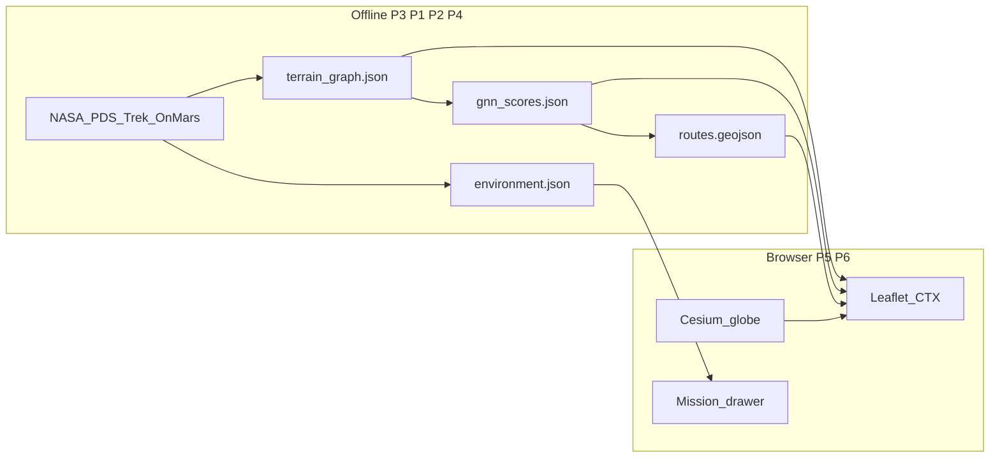
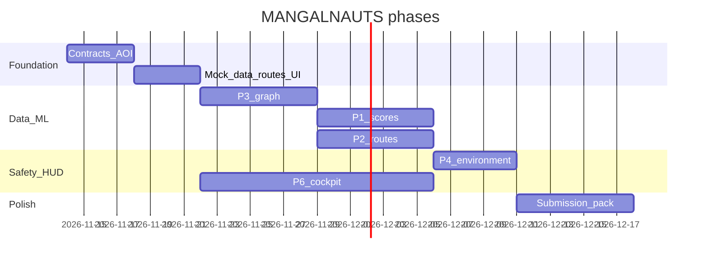

# MANGALNAUTS — Martian Mission OS (whole project plan)

**Repo root:** `MANGALNAUTS/` (this folder).  
**Challenge:** [Interplanetary Survival Guide: Martian Map](https://www.spaceappschallenge.org/2026/challenges/interplanetary-survival-guide-martian-map/)  
**Delivery model:** Full six-role vision over several weeks; **runtime = static site** + precomputed `data/jezero/v1/*.json|geojson` (no live ML API required at demo).

---

## Team roles at a glance

| # | Role | Builds | Demo output |
|---|------|--------|-------------|
| P1 | GNN Model Architect | PyG GAT/GCN | `gnn_scores.json` (risk 0–1, science 0–100%) |
| P2 | Neural Pathfinder | A* / Neural A* | `routes.geojson` (highway ≤20°, walk ≤15°, abort) |
| P3 | Geospatial Data Engineer | HiRISE/MOLA/THEMIS/CRISM pipeline | `terrain_graph.json`, `aoi.geojson` |
| P4 | Environmental & Radiation Safety | REMS/RAD/MCS planning data | `environment.json` + `alerts[]` |
| P5 | Web GIS / Map Engine | Cesium + Leaflet overlays | Heatmap, routes, 60 FPS on detail map |
| P6 | Cockpit HUD / Mission OS | Dashboard, modes, drawer | ROVER/WALK, telemetry, science UI |

**Dependencies (not fully sequential):** P3 graph **blocks** real P1/P2; P5/P6 can use **mock data** in parallel from day one. P4 feeds P6 alerts; does not block the graph.

---

## Challenge fit

NASA wants a **layered, integrated view** of a **route or site** for a **safe, science-rich Marswalk** using **multiple NASA missions**.

**Product thesis:** Mission OS for one area of interest — **Jezero Crater** — globe (optical/thermal/topography filters) → zoom to surface → **risk heatmap** + **ROVER highway** / **Marswalk loop** + **abort** + **conditions/alerts**.

**Built today (P5/P6 baseline):**

- [`index.html`](index.html) — cockpit shell  
- [`js/globe.js`](js/globe.js) — Cesium Mars globe, Trek filters, MDEM terrain  
- [`js/hybrid.js`](js/hybrid.js) — &lt; ~400 km → CTX detail pane  
- [`js/detail-map.js`](js/detail-map.js) — Leaflet CTX + MColorDEM  
- [`js/app.js`](js/app.js) — filter UI, HUD, jump-to ([`js/config/places.js`](js/config/places.js))

Rough completion: **P5 ~40%**, **P6 ~25%** (HUD labels, detail header; no routes/heatmap/drawer/modes yet).

---

## P5 vs P6 (who owns what)

### P5 — Map engine

- Everything that **renders** Mars: globe, tiles, terrain, hybrid camera, **heatmap**, **route lines**, click → node id  
- Load artifacts via [`js/api/manifest.js`](js/api/manifest.js) (to add)  
- Performance: precomputed heatmap on **detail map**; avoid per-frame GNN in browser  

### P6 — Mission OS

- **ROVER / WALK** mode, slide-out **drawer** (GNN stats, route summary, NASA surface photos)  
- Telemetry meters (O₂, battery, EVA time — planning assumptions, not flight rules)  
- P4 **alert banner**, abort CTA, [`docs/ASSUMPTIONS.md`](docs/ASSUMPTIONS.md), demo narrative  

**Contract:** P5 draws; P6 explains. Shared JSON schemas below.

---

## Architecture (static-data pipeline)



P3–P4 publish under **`data/jezero/v1/`** plus [`data/manifest.json`](data/manifest.json) (bbox, version, build time, citations).

---

## Shared data contracts (week 1 sign-off)

| Artifact | Owner | Schema (summary) |
|----------|--------|------------------|
| `aoi.geojson` | P3/P5 | Polygon bbox; lon/lat; Mars 2000 note |
| `terrain_graph.json` | P3 | `nodes[]` `{id, lat, lon, elev_m, slope_deg, themis_I, crism_class?}`; `edges[]` `{from, to, length_m, cost_base}` |
| `gnn_scores.json` | P1 | `nodes[id]` `{risk_0_1, science_0_100}` + `model_meta` |
| `routes.geojson` | P2 | Features: `highway_rover`, `loop_walk`, `abort_emergency` (properties: max_slope_deg, length_m) |
| `environment.json` | P4 | `{site, sol, temp_C, wind_m_s, sunset_utc, rad_dose_proxy, flare_level, alerts[]}` |
| `science_stops.geojson` | P3/P2 | Point features for CRISM/high-science nodes |

**Critical:** stable **`node.id`** from P3 → used by P1, P2, P5 click lookup, P6 drawer.

### Example alert object (P4 → P6)

```json
{
  "code": "COLD_EVA",
  "severity": "warning",
  "message": "Forecast below suit thermal limit after sunset.",
  "sunset_in_min": 142
}
```

---

## Repository layout (target)

All paths relative to **`MANGALNAUTS/`**:

```
MANGALNAUTS/
  index.html
  plan.md
  README.md
  css/styles.css
  js/
    globe.js, hybrid.js, detail-map.js, app.js, config/
    map/              # P5 NEW: heatmap.js, routes.js, pick.js
    mission/          # P6 NEW: hud.js, modes.js, drawer.js, telemetry.js
    api/              # NEW: manifest.js
  data/
    manifest.json
    jezero/v1/
      aoi.geojson
      terrain_graph.json
      gnn_scores.json
      routes.geojson
      environment.json
      science_stops.geojson
      heatmap_preview.png   # optional
  python/               # offline only
    pipeline/build_graph.py, sample_themis.py, sample_crism.py
    ml/train_gnn.py, export_scores.py
    routing/neural_astar.py, export_routes.py
    safety/rems_rad_snapshot.py
  docs/
    DATA_CITATIONS.md
    ASSUMPTIONS.md
    DEMO_SCRIPT.md
```

**Run app:**

```bash
cd MANGALNAUTS
python -m http.server 8080
```

Open `http://localhost:8080/`.

---

## Per-person phases

### P3 — Geospatial pipeline

| Phase | Deliverable |
|-------|-------------|
| 1 | `aoi.geojson`, MOLA/MDEM slope grid; HiRISE footprint index (ODE) |
| 2 | THEMIS thermal inertia bins; CRISM mineral flags per node |
| 3 | Optional HiRISE corridor refinement near planned routes |

### P1 — GNN

| Phase | Deliverable |
|-------|-------------|
| 1 | Heuristic `gnn_scores.json` from slope + THEMIS (+ CRISM) to unblock UI |
| 2 | Trained GNN; batch export; document &lt;150 ms inference on AOI |
| 3 | (Optional) subgraph scoring — out of scope for static-json demo |

### P2 — Routing

| Phase | Deliverable |
|-------|-------------|
| 1 | Classical A* / Dijkstra, slope caps, `routes.geojson` |
| 2 | Learned edge costs / Neural A* heuristic |
| 3 | Abort path to habitat waypoint; worst-segment metadata |

### P4 — Safety / environment

| Phase | Deliverable |
|-------|-------------|
| 1 | `environment.json` template; REMS/RAD representative sol (cite Curiosity as proxy if needed) |
| 2 | Sunset countdown; MCS reference wind/temp for season |
| 3 | `alerts[]` consumed by P6 banner |

### P5 — Map engine

| Phase | Deliverable |
|-------|-------------|
| 1 | `manifest.js` + route layers on `detail-map.js` |
| 2 | Heatmap from `gnn_scores.json`; layer legend |
| 3 | Node pick → highlight; globe stays filter-focused (heatmap optional low-res) |

### P6 — Cockpit

| Phase | Deliverable |
|-------|-------------|
| 1 | ROVER/WALK toggle; mission drawer shell |
| 2 | Telemetry strip; link to assumptions doc |
| 3 | Alerts, abort fly-to, NASA Image API thumbs at science stops |

---

## Week milestones

| Week | Goal | Ship? |
|------|------|-------|
| 1 | Contracts + **mock** `data/jezero/v1/*` + routes on map + ROVER/WALK UI | Yes |
| 2 | Real graph, scores, three routes, heatmap | Yes |
| 3 | Environment + alerts + drawer content | Yes |
| 4 | Citations, demo script, pitch video story | Submit |



---

## NASA judging checklist

- ≥ **3 data types** on the same AO: optical (CTX/Viking), thermal (THEMIS), topography (MOLA), spectral (CRISM)  
- **Safety-first** routing with slope/obstacle called out in UI  
- **Cite every source** in `docs/DATA_CITATIONS.md` and app footer  
- Demo arc: problem → Jezero science goal → globe filters → zoom → routes → abort → conditions  

---

## Risks

| Risk | Mitigation |
|------|------------|
| GNN late | Ship heuristic scores in same `gnn_scores.json` schema |
| Neural A* late | Classical A* with GNN edge weights |
| Heatmap perf | Detail map only; PNG preview optional |
| No REMS at Jezero | MCS + Curiosity analog; disclaim in ASSUMPTIONS.md |
| Parallel drift | Lock `manifest.json` version weekly |

---

## Success criteria

1. 3D globe with Trek filters (done).  
2. Jezero detail: heatmap + highway / walk loop / abort.  
3. ROVER vs WALK changes visible routes + policy text.  
4. Click → drawer: risk, science %, mineral note, NASA image.  
5. Alerts: sunset, temp, flare-style events from `environment.json`.  
6. Full NASA data citations.  

---

## Immediate next steps

1. **Team:** sign `aoi.geojson` bbox (Jezero) aligned with `js/config/places.js` (18.44°N, 77.58°E).  
2. **P3:** scaffold `python/pipeline/build_graph.py`.  
3. **P5/P6:** add `data/manifest.json` + mock bundle; implement `js/map/routes.js` and `js/mission/modes.js`.  
4. **All:** read challenge Resources tab and add URLs to `docs/DATA_CITATIONS.md` as you touch each dataset.