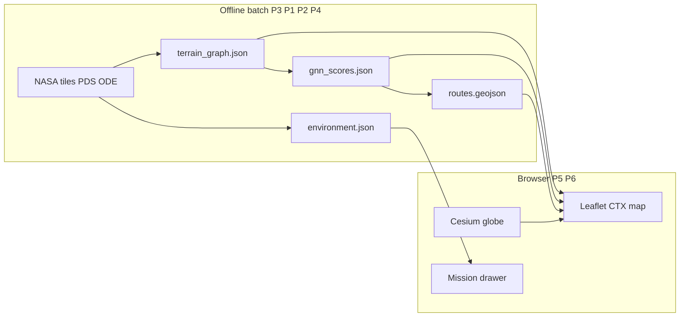
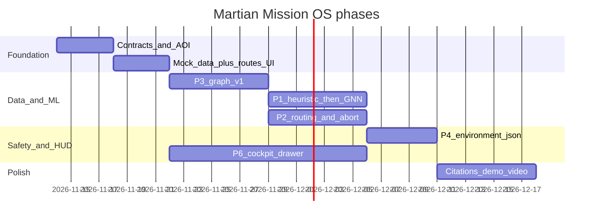

# Martian Map — Whole Project Plan

## Challenge fit

NASA asks for a **layered, integrated view** of a **location or route** that helps a suited astronaut plan a **safe, science-rich Marswalk**, using **multiple NASA missions** ([challenge brief](https://www.spaceappschallenge.org/2026/challenges/interplanetary-survival-guide-martian-map/)).

**Product thesis:** *Mission OS for one AO* — **Jezero Crater** (rich CTX/HiRISE, Perseverance ground truth, challenge examples). User flows: globe → filter stacks (optical/thermal/topography) → zoom to surface → **ROVER highway** vs **Marswalk loop** with **risk heatmap**, **science stops**, **P4 conditions/alerts**, and **abort path**.

**What exists today** ([`index.html`](D:\NASA Space challenge\index.html), [`js/globe.js`](D:\NASA Space challenge\js\globe.js), [`js/hybrid.js`](D:\NASA Space challenge\js\hybrid.js), [`js/detail-map.js`](D:\NASA Space challenge\js\detail-map.js)): 3D Trek globe, hybrid CTX detail pane, jump-to presets — **P5 baseline ~40% done**; **P6 shell ~25%** (HUD labels, detail header only).

---

## Target architecture (static-data pipeline)

You chose **precompute → files in repo** for hackathon reliability and “full vision” over time. Runtime = static site + `python -m http.server`; no required GPU at demo time.



**Integration rule:** P3–P4 never talk to the browser directly; they publish versioned artifacts under `data/jezero/v1/` with a small [`data/manifest.json`](D:\NASA Space challenge\data\manifest.json) (AOI bbox, resolution, build time, citations).

---

## Shared contracts (agree in week 1)

| Artifact | Owner | Contents |
|----------|--------|----------|
| `aoi.geojson` | P3/P5 | Polygon bbox, CRS note (Mars 2000 / lon-lat) |
| `terrain_graph.json` | P3 | `nodes[]`: `{id, lat, lon, elev_m, slope_deg, themis_I, crism_class?}`; `edges[]`: `{from, to, length_m, cost_base}` |
| `gnn_scores.json` | P1 | `nodes[id]`: `{risk_0_1, science_0_100}` + model metadata |
| `routes.geojson` | P2 | FeatureCollection: `highway_rover` (slope ≤20°), `loop_walk` (≤15°), `abort_emergency` |
| `environment.json` | P4 | `{site, sol, temp_C, wind_m_s, sunset_utc, rad_dose_proxy, flare_level, alerts[]}` |
| `science_stops.geojson` | P3/P2 | CRISM/mineral highlights as points |

**Node ID stability** is the critical contract: P1 and P2 must use P3’s `id` field; P5 maps clicks to nearest node via `id` or grid index.

---

## Repository layout (end state)

```
D:\NASA Space challenge\
  index.html
  css/
  js/
    globe.js, hybrid.js, detail-map.js, app.js   # P5 core (existing)
    map/                                         # NEW P5 overlays
      heatmap.js
      routes.js
      pick.js
    mission/                                     # NEW P6
      hud.js
      modes.js
      drawer.js
      telemetry.js
    api/                                         # NEW client loaders
      manifest.js
  data/
    manifest.json
    jezero/v1/
      aoi.geojson
      terrain_graph.json
      gnn_scores.json
      routes.geojson
      environment.json
      science_stops.geojson
      heatmap_preview.png            # optional fast preview layer
  python/                            # NEW P3–P4 offline (not required at runtime)
    pipeline/
      build_graph.py
      sample_the_mis.py
      sample_crism.py
    ml/
      train_gnn.py
      export_scores.py
    routing/
      neural_astar.py                # or classical A* + learned heuristic v1
      export_routes.py
    safety/
      rems_rad_snapshot.py
  docs/
    DATA_CITATIONS.md
    ASSUMPTIONS.md
    DEMO_SCRIPT.md
  README.md
```

---

## Six roles — deliverables and phases

### Person 3 — NASA Geospatial Data Engineer

**Build:** Jezero AOI graph from NASA products.

| Phase | Deliverable |
|-------|-------------|
| **1** | `aoi.geojson`, coarse 200–463 m lattice from MOLA/MDEM slope; ODE HiRISE footprint index for AOI |
| **2** | THEMIS thermal inertia bins (rock vs sand proxy) per node; CRISM class or simplified mineral flag |
| **3** | HiRISE-driven refinement patch (optional higher-res subgraph near route corridor) |

**Sources:** Mars Trek/OnMars (already in app), PDS ODE, HiRISE/CRISM searches (per challenge resources).

---

### Person 1 — GNN Model Architect

**Build:** PyTorch Geometric GAT/GCN → traversability risk + science value.

| Phase | Deliverable |
|-------|-------------|
| **1** | Features from P3 tensor; baseline **heuristic** scores (`risk = f(slope, themis)`, `science = f(crism)`) exported as `gnn_scores.json` so P5/P6 unblock |
| **2** | Trained GNN; ablation doc; inference **<150 ms** on full AOI → batch export only (static JSON at demo) |
| **3** | Optional: small subgraph API later; **not required** for your static-json choice |

**Edge features:** slope, thermal inertia, elevation change; **labels:** weak supervision from slope/themis until human labels exist.

---

### Person 2 — Neural Pathfinder and Route Optimizer

**Build:** Paths on P3 graph with P1 costs.

| Phase | Deliverable |
|-------|-------------|
| **1** | Classical A* / Dijkstra with slope caps (20° rover, 15° walk) + `routes.geojson` |
| **2** | “Neural A*” — learned heuristic or edge cost from GNN embeddings; same output schema |
| **3** | Abort path: shortest low-risk exit to habitat waypoint; metadata on worst segment |

---

### Person 4 — Environmental and Radiation Safety Engineer

**Build:** Planning-time “current conditions” from NASA archives (not live ops).

| Phase | Deliverable |
|-------|-------------|
| **1** | `environment.json` template + REMS/RAD **representative sol** for Jezero region (Curiosity archive as proxy with clear caveat) |
| **2** | Sunset countdown from astronomy + MCS **reference** temp/wind for season |
| **3** | `alerts[]` schema (e.g. `FLARE`, `COLD_EVA`, `DUST`) consumed by P6 |

---

### Person 5 — Interactive Web GIS and Map Engine Lead

**Build:** Rendering and interaction on top of existing stack.

| Phase | Deliverable |
|-------|-------------|
| **1** | [`js/api/manifest.js`](D:\NASA Space challenge\js\api\manifest.js) loads `data/`; extend [`detail-map.js`](D:\NASA Space challenge\js\detail-map.js) with route layers + legend |
| **2** | Heatmap (canvas or Leaflet plugin) from `gnn_scores.json`; THEMIS overlay toggle on detail map |
| **3** | Globe: low-res heatmap draped or omitted for perf; click → nearest node highlight; 60 FPS = **precomputed** heatmap, not per-frame GNN |

**Keep:** Cesium globe + hybrid threshold in [`hybrid.js`](D:\NASA Space challenge\js\hybrid.js); challenge wants **hyperlocal** view — detail pane is primary ops map.

---

### Person 6 — Astronaut Cockpit HUD and Mission OS Lead

**Build:** Mission narrative and controls.

| Phase | Deliverable |
|-------|-------------|
| **1** | **ROVER / WALK** mode in header; slide-out **mission drawer** (GNN stats, route summary, assumptions link) |
| **2** | Telemetry meters (O₂, battery, EVA time) — static demo profiles + labels from [`docs/ASSUMPTIONS.md`](D:\NASA Space challenge\docs\ASSUMPTIONS.md) |
| **3** | P4 alert banner; “Abort route” button flies map to emergency polyline; NASA Image API thumbnails at science stops |

**Refactor:** Thin [`app.js`](D:\NASA Space challenge\js\app.js) → import `mission/hud.js` + `mission/modes.js` so P6 owns UI without breaking globe init.

---

## Phased timeline (full vision, static JSON)



| Week | Milestone | Demo-able |
|------|-----------|-----------|
| **1** | Manifest + mock `routes.geojson` + ROVER/WALK on Jezero detail map | Yes |
| **2** | Real P3 graph; P1 scores; P2 three routes; heatmap on map | Yes |
| **3** | P4 alerts in HUD; drawer with science stops + images | Yes |
| **4** | Judging package: citations, limitations, 3-min pitch script | Submit |

---

## NASA challenge checklist (judging)

- **≥3 data types** on same route: optical (CTX/Viking), thermal (THEMIS), topography (MOLA), spectral (CRISM) — map filters + graph features.
- **Safety-first route** with obstacles/slope called out in drawer and route metadata.
- **Cite every source** in `docs/DATA_CITATIONS.md` and UI footer.
- **Presentation:** problem → Jezero science goal → demo globe → zoom → routes → abort → conditions.

---

## Risks and mitigations

| Risk | Mitigation |
|------|------------|
| GNN not ready | Ship P1 heuristic scores under same JSON schema; swap file in `data/jezero/v1/` |
| Neural A* slips | Ship classical A*; rename to “cost-optimized path” in README |
| Cesium perf with heatmap | Heatmap **only on Leaflet detail** map |
| REMS not at Jezero | Use MCS reference + Curiosity REMS with explicit “analog conditions” disclaimer (P4) |
| Team parallel drift | Weekly lock on `manifest.json` version + node ID schema |

---

## Success criteria (full vision)

1. User can explore Mars in 3D with Trek filters (existing).
2. Zoom to Jezero → CTX detail with **risk heatmap** and **three route types**.
3. ROVER vs WALK toggles visible routes and slope policy copy (P6).
4. Click node/stop → drawer shows **risk, science %, mineral note, NASA photo**.
5. Banner shows **sunset / temp / flare-style alert** from `environment.json`.
6. All artifacts traceable to NASA data in citations doc.

---

## Immediate next steps (when leaving Plan mode)

1. Add `data/manifest.json` + mock Jezero bundle for P5/P6 integration testing.
2. Split `app.js` mission UI into `js/mission/*` (P6).
3. Add `js/map/routes.js` + `heatmap.js` wired to `MarsDetailMap` (P5).
4. P3 starts `python/pipeline/build_graph.py` for Jezero bbox aligned with [`js/config/places.js`](D:\NASA Space challenge\js\config\places.js) Jezero center.

No changes to the attached plan file from the prior 3D globe work; this plan **extends** that codebase rather than replacing it.